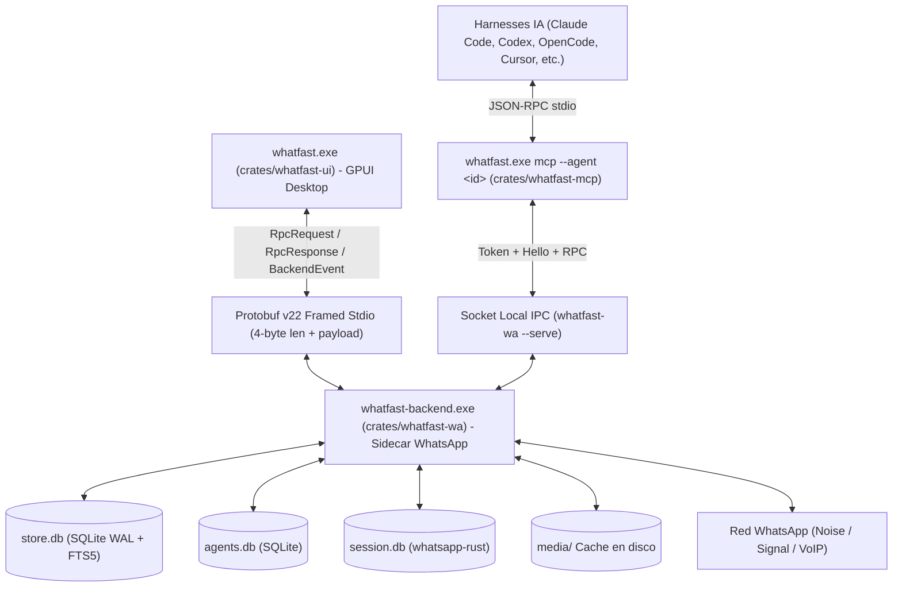
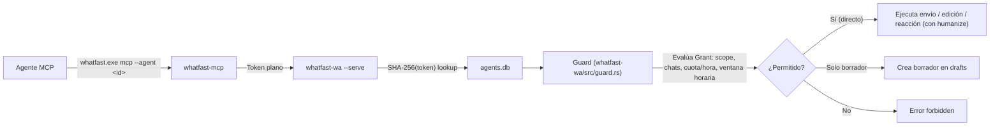

# Arquitectura de `whatfast-rs`

`whatfast-rs` es un cliente de escritorio nativo para WhatsApp escrito en **Rust** sobre **GPUI** (sin WebView, sin Chromium y sin Electron), acompañado por un sidecar nativo en Rust (`whatfast-wa` / `whatfast-backend`) basado en `whatsapp-rust` y un ecosistema integrado de agentes IA vía **MCP** (Model Context Protocol).

---

## 1. Principios de diseño

1. **Cero WebView**: toda la interfaz se renderiza directamente en GPU mediante GPUI (`gpui` + `gpui-component`), eliminando el consumo de memoria y latencia de un navegador embebido.
2. **Aislamiento de credenciales y red**: las claves de sesión de WhatsApp (`session.db`) y la conexión Noise/Signal viven exclusivamente en el proceso sidecar (`whatfast-backend`). La UI nunca accede directamente a las credenciales de dispositivo vinculado.
3. **Separación estricta por capas**:
   - Lógica pura y formateo sin dependencias de UI ni red (`whatfast-core`).
   - Modelo de datos y configuración sin GPUI (`whatfast-model`).
   - Contrato binario compartido (`whatfast-protocol` + `proto/bridge.proto`).
   - Interfaz reactiva (`whatfast-ui`) y sidecar de protocolo/persistencia (`whatfast-wa`).
4. **Paridad multiplataforma (Windows + Linux X11/Wayland + macOS)**: las integraciones de sistema (medios, audio, captura de pantalla, autostart, biometría, bandeja y fuentes de emoji) encapsulan rutas específicas por plataforma detrás de interfaces uniformes.
5. **Seguridad por defecto para agentes IA**: los agentes externos operan mediante tokens individuales con hash SHA-256 y reglas granulares evaluadas por `Guard` antes de tocar cualquier conversación.

---

## 2. Topología del sistema

---

## 3. Workspace y responsabilidades por crate

El workspace de Cargo (`Cargo.toml`, Rust edition `2024`, MSRV `1.88`) se compone de **9 crates** y un parche vendoreado:

| Crate | Ruta | Responsabilidad principal |
|---|---|---|
| `whatfast-core` | [crates/whatfast-core](file:///G:/Proyectos/17-whatfast-rs/crates/whatfast-core) | Lógica pura sin async/red/GPUI: parser Markdown y diagramas (`markdown.rs`, `diagrams.rs`), formato de texto WhatsApp (`whatsapp_formatting.rs`, `message_format.rs`), recorte de medios (`media_crop.rs`), teléfonos (`phone.rs`), temas y tokens (`theme.rs`), navegación de pestañas (`tab_keyboard.rs`), métricas (`performance.rs`). |
| `whatfast-model` | [crates/whatfast-model](file:///G:/Proyectos/17-whatfast-rs/crates/whatfast-model) | Estado serializable y modelos de dominio sin GPUI: `Store` (`model.rs`), rutas por perfil `WHATFAST_PROFILE` (`paths.rs`), `Settings` (`settings.rs`), favoritos (`favorites.rs`), destacados (`starred.rs`), stickers (`sticker.rs`), catálogo de emojis (`emoji_picker.rs`). |
| `whatfast-protocol` | [crates/whatfast-protocol](file:///G:/Proyectos/17-whatfast-rs/crates/whatfast-protocol) | Código generado desde [bridge.proto](file:///G:/Proyectos/17-whatfast-rs/proto/bridge.proto) (`prost`), cliente de transporte enmarcado (`transport.rs`), modo local (`local.rs`) y backend simulado para pruebas (`fake.rs`). |
| `whatfast-i18n` | [crates/whatfast-i18n](file:///G:/Proyectos/17-whatfast-rs/crates/whatfast-i18n) | Sistema de internacionalización por clave inglesa (`i18n::t`). `build.rs` descubre e incrusta `locales/*.json` (`en`, `es`, `zh`). |
| `whatfast-agents` | [crates/whatfast-agents](file:///G:/Proyectos/17-whatfast-rs/crates/whatfast-agents) | Catálogo declarativo de 9 harnesses (`spec.rs`), detección en PATH/sistema (`detect.rs`, `paths.rs`), emisión y revocación de tokens (`token.rs`), escritura segura en JSON/JSONC/TOML/YAML (`write.rs`) e instalación de guías/reglas (`guide.rs`). |
| `whatfast-auto` | [crates/whatfast-auto](file:///G:/Proyectos/17-whatfast-rs/crates/whatfast-auto) | Persistencia y motor de automatización de agentes: esquema `agents.db` (`db.rs`), evaluación de permisos (`grant.rs`), fragmentación y pausas humanas (`humanize.rs`), parser cron de 5 campos (`cron.rs`), ejecución headless (`runner.rs`), armado de prompts Quick Ask (`ask.rs`). |
| `whatfast-mcp` | [crates/whatfast-mcp](file:///G:/Proyectos/17-whatfast-rs/crates/whatfast-mcp) | Servidor MCP JSON-RPC sobre stdio (`server.rs`), cliente del socket local (`client.rs`), framing (`framing.rs`) y 16 herramientas expuestas (`tools.rs`). |
| `whatfast-wa` | [crates/whatfast-wa](file:///G:/Proyectos/17-whatfast-rs/crates/whatfast-wa) | Sidecar vivo en Rust sobre `whatsapp-rust` (feature `voip`). Gestiona sesión (`session.rs`), ingesta (`ingest.rs`), base SQLite + FTS5 (`db.rs`), envíos (`send.rs`), medios (`media.rs`, `storage.rs`), llamadas (`calls.rs`), servidor RPC (`server.rs`), socket de agentes (`socket.rs`), `Guard` (`guard.rs`), borradores (`drafts.rs`), programación (`schedules.rs`, `scheduler.rs`), vistas previas (`link_preview.rs`) e identidad LID/teléfono (`identity.rs`, `reconcile.rs`). |
| `whatfast-ui` | [crates/whatfast-ui](file:///G:/Proyectos/17-whatfast-rs/crates/whatfast-ui) | Aplicación de escritorio GPUI (`main.rs`, `app.rs`, `render.rs`, `rpc.rs`, `tokens.rs` y 45+ módulos especializados de UI, audio, video, VoIP, editor de medios, accesibilidad y sistema). |
| `gpui_windows` *(vendor)* | [vendor/gpui_windows](file:///G:/Proyectos/17-whatfast-rs/vendor/gpui_windows) | Parche local sobre el backend DirectWrite de GPUI para rasterizar fuentes bitmap de emojis (`CBDT`/`CBLC`) con conversión RGBA→BGRA y colapsado de ligaduras `GSUB` `LookupType 4` (`GsubLigatures`) para variantes de tono de piel y secuencias ZWJ. |

> **Nota sobre `backend/`**: El directorio [backend/](file:///G:/Proyectos/17-whatfast-rs/backend) contiene el sidecar legado en Go, mantenido únicamente como referencia histórica de la migración; el contrato v22 activo lo implementa `crates/whatfast-wa`.

---

## 4. Contrato IPC y transporte (`bridge.proto` v22)

La comunicación entre `whatfast-ui` y `whatfast-wa` (y entre `whatfast-mcp` y `whatfast-wa --serve`) utiliza **Protobuf v22** definido en [bridge.proto](file:///G:/Proyectos/17-whatfast-rs/proto/bridge.proto) sobre un canal binario enmarcado ([transport.rs](file:///G:/Proyectos/17-whatfast-rs/crates/whatfast-protocol/src/transport.rs)):

- **Framing**: prefijo de longitud de 4 bytes big-endian seguido del payload `Envelope` (`RpcRequest`, `RpcResponse`, `BackendEvent`, `ShutdownRequest`).
- **Límites**:
  - `PROTOCOL_VERSION = 22`
  - `MAX_FRAME_BYTES = 8 * 1024 * 1024` (8 MiB)
  - `MAX_PENDING_REQUESTS = 512`
- **Timeouts diferenciados**:
  - Control (`Hello`, auth, sync): **15 s**
  - Lectura (`ListChats`, `ListMessages`, avatares): **30 s**
  - Escritura (`SendText`, `MarkRead`, pairing): **60 s**
  - Adjuntos (subida/descarga de medios): **22 min**
- **Resiliencia**: el transporte mantiene colas `async_channel` acotadas (256 salientes, 1024 entrantes), captura los últimos 8 KiB de `stderr` para diagnosticar fallos del sidecar y otorga 3 s de gracia en `Shutdown`.

---

## 5. Concurrencia, memoria y pipelines multimedia

1. **Asignador global (`mimalloc`)**: tanto `whatfast-ui` como `whatfast-wa` usan `mimalloc::MiMalloc` para reducir contención entre hilos en asignaciones frecuentes de frames Protobuf, audio PCM y bitmaps.
2. **Modelo reactivo sin bloqueo en UI**:
   - Los RPC hacia el sidecar corren en hilos/canales dedicados (`rpc.rs`) y notifican a la vista vía `cx.notify()`.
   - El bucle de `whatfast-wa` delega operaciones de red bloqueantes (resolución de avatares `resolve_avatar`, acuses `mark_read_rows`, descargas de medios) a tareas independientes para no frenar lecturas locales de SQLite.
3. **Almacenamiento SQLite**:
   - `store.db` opera en modo **WAL** permitiendo lecturas concurrentes junto a escrituras de ingesta.
   - Búsqueda de texto completo indexada mediante tabla virtual **FTS5 con tokenizador trigram** (`messages_fts`) actualizada por triggers SQL.
   - Tabla `outbox` para encolar mensajes salientes cuando el cliente está desconectado y drenarlos al reconectar.
4. **Pipelines de audio, video y llamadas**:
   - **Notas de voz**: grabación en Rust puro a Ogg Opus (`opus-pure` en `recording.rs`); reproducción con decodificación + *time-stretching* **WSOLA** sin cambio de tono (`audio.rs`); transcripción opcional mediante `whisper` / `whisper-cli`.
   - **Reproducción de video**: decodificación nativa con **Windows Media Foundation** en Windows y backend **`ffmpeg`** en Unix (`video.rs`), con soporte de `Seek`, control de velocidad y volumen.
   - **Llamadas VoIP**: captura/reproducción PCM `i16` LE a 16 kHz (`call_audio.rs`) con cancelador de eco adaptativo **NLMS** y *noise gate*; captura de cámara y pantalla (`gdigrab` en Windows, `x11grab` en Linux en `call_video.rs`) codificada a H.264 sobre el puente RPC.

---

## 6. Arquitectura de seguridad y gobierno de agentes IA

- **Autenticación por agente**: cada agente recibe un token único generado por `whatfast-agents/src/token.rs`; en `agents.db` solo se almacena su hash SHA-256.
- **Control de acceso (`whatfast-auto/src/grant.rs` + `whatfast-wa/src/guard.rs`)**: restringe por alcance (`read`, `draft`, `send`, `react`, etc.), lista blanca de chats, exclusión de grupos salvo autorización explícita, límite de acciones por hora y ventana horaria local.
- **Protección local**:
  - **App Lock** (`app_lock.rs`): hash con **PBKDF2-SHA256** + sal aleatoria, bloqueo automático por inactividad, desenfoque al perder foco y desbloqueo biométrico en Linux vía `fprintd-verify`.
  - **Lock de instancia única** (`instance.rs`): `whatfast.lock` registra PID y nombre del proceso para evitar falsos bloqueos tras reinicios en Windows.
  - **Higiene de secretos**: hook `.githooks/pre-commit` + `scripts/chequear-secretos.py`.

---

## 7. Compilación, verificación y distribución

- **Compilación**: `scripts\lint.cmd` (`cargo clippy --workspace --all-targets -- -D warnings`), `scripts\test.cmd` (`cargo test --workspace`), `scripts\build.cmd` (`--release` con `opt-level = 3`, `lto = true`, `codegen-units = 1`, `strip = "symbols"`). Equivalentes `.sh` en Linux/macOS.
- **Compuertas de calidad**:
  - `python scripts\idiomas.py --strict`: exige 100% de cobertura en `en`, `es` y `zh`.
  - `python scripts\funcionalidad.py` y `python scripts\probar-mcp.py`: verifican cobertura de RPCs y herramientas MCP.
- **Instalación y CI/CD**: `scripts\instalar.ps1` / `installer.nsi` (Windows) y `scripts\instalar.sh` / `.github/workflows/release.yml` (paquetes para Windows, Linux `.tar.gz` + `.desktop` y macOS `.app`).
