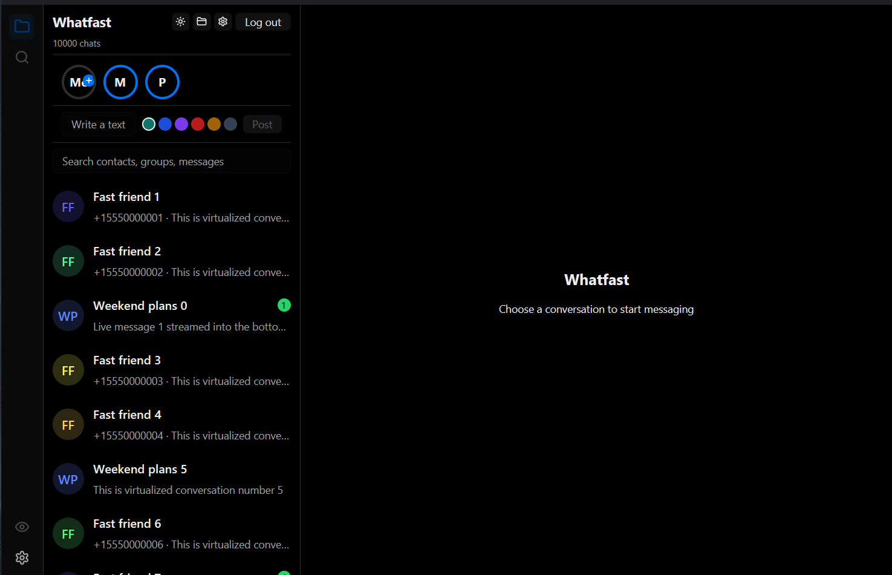
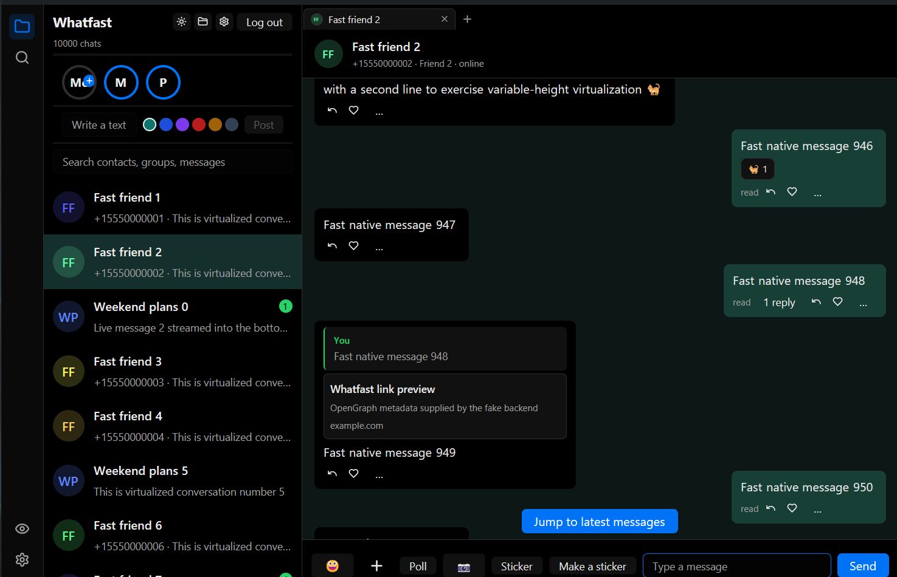
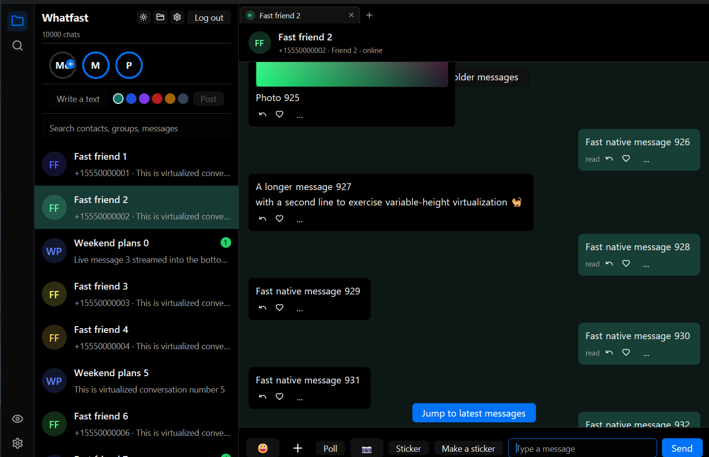

# Whatfast

Cliente de escritorio de WhatsApp, rápido y chico. No es una página web
empaquetada: es una **app nativa escrita en Rust** que dibuja con GPUI
(sin webview, sin DOM, sin motor de navegador), con un motor en Go que habla
el protocolo de dispositivos vinculados.



> **Estado:** beta privada. Es un cliente no oficial. La cuenta de WhatsApp
> nunca entra en el proceso que dibuja la pantalla.

---

## Contenido

- [Qué es](#qué-es)
- [Capturas](#capturas)
- [Quéfast contra el cliente anterior, contra WhatsApp Web y contra la app de Windows](#quéfast-contra-el-cliente-anterior-contra-whatsapp-web-y-contra-la-app-de-windows)
- [Dónde Whatfast gana de verdad](#dónde-whatfast-gana-de-verdad)
- [Dónde todavía pierde](#dónde-todavía-pierde)
- [Cómo está armado](#cómo-está-armado)
- [Compilar y correr](#compilar-y-correr)
- [Checks](#checks)
- [Protocolo](#protocolo)

---

## Qué es

- **Interfaz nativa en Rust (GPUI)**: dibuja directamente. No hay webview, no
  hay DOM, no hay Chromium.
- **Dominio en Rust puro** (`whatfast-core`): 25 módulos sin una sola
  dependencia de la interfaz, con los 153 casos de prueba del cliente
  anterior portados uno por uno.
- **Sidecar en Go** (`whatsmeow`) como único dueño de la conexión, el
  historial, los medios y las bases de datos.
- **Paridad con el cliente web**: pide los **50 RPC** del sidecar y tiene los
  **21 componentes** de la app web (la columna de iconos, el strip de pestañas,
  el panel de newsletters, la tira de estados, el panel de miembros, la
  bandeja de stickers, el editor de imagen, el menú del mensaje, el reenvío,
  las encuestas y el clip de adjuntos). Lo comprueba
  `python scripts\funcionalidad.py`.

La interfaz nunca ve tus credenciales: el QR, el token del dispositivo y las
bases de datos viven en el sidecar, y la interfaz habla con él por RPC
tipados con protobuf.

Todo el historial es **local** (SQLite: `session.db` y `client.db`).

---

## Capturas

Todas las capturas son del **backend de demostración** de la propia app (sin
cuenta real, sin QR, sin red): los chats y los contactos están simulados
dentro del repositorio.

### Lista de chats

La columna de iconos de la izquierda, la tira de estados, el buscador y la
lista de chats (10.000 simulados, virtualizada).


### Conversación

El strip de las conversaciones abiertas arriba, las burbujas con altura
variable, respuestas, reacciones, acuses de lectura, preview de links y el
menú de cada mensaje.



### Mensaje con foto

La imagen la genera el backend de demostración y la dibuja la interfaz
nativa, sin pasar por un webview.



---

## Quéfast contra el cliente anterior, contra WhatsApp Web y contra la app de Windows

Números **medidos el 20/10/2026 en esta máquina** (Windows 11 x86-64, sin
cuenta de WhatsApp). La app de Windows no está instalada acá, así que sus
celdas quedan sin medir y se explican por estructura.

| | **Whatfast (nativo)** | **Whatfast (webview)** | **WhatsApp Web** | **App de Windows** |
|---|---|---|---|---|
| Motor de render | **GPUI (Rust), ninguno** | WebView2 del sistema | el de tu navegador | Chromium propio (Electron) |
| Descarga para instalar | **36,1 MB** (12,4 la app + 23,7 el sidecar) | 33,1 MB | 0 (es una página) | trae su propio Chromium |
| JS que baja el cliente | **0 KB** | 411 KB (127 KB con gzip) | **5.948 KB** solo la pantalla de login | — |
| Ventana visible | 0,84 s | **0,25 s** | — | — |
| UI lista (lista de chats) | ~1,0 s | 1,16 s | — | — |
| RAM del código propio (interfaz + sidecar) | **60,7 MB + 31,6 MB = 92,3 MB** | 25,6 MB + 31,8 MB = 57,4 MB | 79 MB de heap JS en la sola pantalla de login | — |
| RAM del motor de render | **0** (no hay) | 366,8 MB (WebView2, **compartido con Windows**) | el navegador ya abierto: **612,7 MB** medidos con Brave y 6 pestañas | — |
| RAM total en reposo | **92,3 MB** | **432 MB** | el del navegador + la pestaña | — |
| Base de datos | SQLite local, en tu disco | SQLite local | en el navegador | local, pero no tuya |
| Credenciales en el proceso del render | nunca | nunca | sí | sí |

Cómo se midió, para que puedas repetirlo:

- **Whatfast**: `dist\whatfast.exe` lanzado con el sidecar real
  (`scripts\medir.ps1 -ConSidecar`), 20 s después se suma el working set del
  árbol de procesos (interfaz + `whatfast-backend`), sin las consolas
  heredadas. Mediana de 3 corridas. La ventana se cuenta desde `Start-Process`
  hasta que aparece el handle; la lista de chats, con
  `scripts\medir-lista.ps1`. La captura del código propio es el binario de
  release.
- **La lista de chats**: se capturan los píxeles de la ventana cada 80 ms
  desde el arranque y se toma el primer cambio grande de la imagen.
- **El cliente anterior**: las cifras están en el README de
  `Owning01/whatfast`, medidas con el mismo procedimiento.

Un detalle: al lanzar la app desde una consola aparecen dos procesos
`conhost` (19 MB) que son de la consola heredada. Al lanzarla desde el
Explorador o desde un instalador no hay consola y no aparecen.

---

## Dónde Whatfast gana de verdad

1. **No te descarga un segundo navegador.** La app no usa WebView2 ni
   Chromium: dibuja con GPUI, que es el motor de Zed. La app oficial de
   Windows, en cambio, trae su propio Chromium en el instalador.
2. **La RAM total bajó de 432 MB a 92,3 MB.** El 85 % de los 432 MB del
   cliente anterior era el WebView2: 366,8 MB. Sin webview, esa fila es
   cero. Los 92,3 MB que quedan son la interfaz (60,7 MB) y el sidecar
   (31,6 MB), que son los mismos que ya usaba el cliente anterior.
3. **No necesita el navegador abierto.** WhatsApp Web es una pestaña más: si
   tenés 40 pestañas, la de WhatsApp se lleva su parte de RAM y de CPU.
4. **Cero JavaScript.** La pantalla de login de WhatsApp Web ya baja 5,8 MB
   de JavaScript; la app oficial viene con un motor entero adentro. Acá no
   baja nada: la UI son 12,4 MB de binario nativo.
5. **El historial es tuyo y es local.** SQLite en tu disco, con control de
   acceso y borrado explícito al desloguear.
6. **El render nunca ve tus credenciales.** El token del dispositivo y las
   bases de datos viven en el sidecar Go; la interfaz solo recibe lo que el
   RPC le pide.
7. **El dominio está verificado.** Los 153 casos de prueba del cliente
   anterior están portados a Rust y un juez de paridad los compara uno por
   uno: `scripts\parity.py` da **153/153**.

---

## Dónde todavía pierde

- **La ventana aparece 0,59 s más tarde** que en el cliente con webview
  (0,84 s contra 0,25 s). El costo es la inicialización de la plataforma de
  GPUI, no el código: la plataforma tarda 244 ms y abrir la ventana 246 ms;
  el tema y `gpui_component` tardan 8 ms juntos. Los 0,5 s de la meta están
  por debajo del piso de la plataforma.
- **Sin notificaciones del sistema.** El cliente web avisa con un toast del
  sistema operativo cuando llega un mensaje de un chat silenciado. La regla
  de cuándo avisar ya está portada y probada (`whatfast-core`), pero falta
  la llamada al sistema: hoy la app no avisa nada con la ventana detrás.
- **Los ajustes son mínimos.** La app tiene la escala de la interfaz y el
  tema; el cliente web tiene además la densidad, el Enter que envía, las
  notificaciones, el idioma, la carpeta de las descargas, la vista partida,
  el ahorro de batería y los temas propios.
- **La interfaz está en inglés.** El cliente web trae el diccionario en
  inglés y en español; la app nativa solo tiene inglés (que es el idioma
  por defecto del cliente web también).
- **Sin llamadas.** El protocolo de dispositivos vinculados no expone
  señalización de VoIP: la app te avisa en vez de fingir una llamada.
- **El historial viejo hay que pedirlo.** WhatsApp no da un total de por
  vida, así que la app no puede prometer un porcentaje: te dice cuántos
  mensajes tiene guardados y te da el botón para pedir más.
- **Los estados se quedan en memoria.** El protocolo de un dispositivo
  vinculado no tiene RPC de estado propio: el cliente web también los
  guarda en memoria.
- **No es un reemplazo de la app oficial.** Es un cliente de escritorio más
  chico, más rápido y con los datos en tu disco.

---

## Cómo está armado

| Crate | Qué es |
|---|---|
| `whatfast-core` | El dominio: formato de mensajes, reacciones, sincronización, tema, notas de voz, recortes. Sin dependencias de la interfaz. |
| `whatfast-protocol` | El contrato (protobuf), el transporte (framing, ciclo de vida de los pedidos, clasificación de la salida) y el backend de demostración. |
| `whatfast-model` | El modelo de datos: chats, mensajes, borradores, avatares, stickers, rutas. Sin GPUI: se testea sin abrir una ventana. |
| `whatfast-ui` | La interfaz: GPUI, sin webview. |
| `backend/` | El sidecar en Go. |

La regla de las capas: **el dominio no sabe que existe una interfaz**. Por
eso `whatfast-core` y `whatfast-model` se prueban sin levantar una ventana, y
por eso la UI es el único crate que depende de GPUI.

---

## Compilar y correr

```sh
scripts/test.cmd        # cargo test --workspace
scripts/lint.cmd        # cargo clippy --all-targets --locked -- -D warnings
scripts/build.cmd       # deja dist\whatfast.exe y dist\whatfast-backend.exe
```

Para correr sin una cuenta de WhatsApp (y sin red), el backend de
demostración trae 10.000 chats simulados:

```sh
dist\whatfast.exe --fake-backend
```

El backend real es el sidecar en Go: el binario tiene que estar al lado del
ejecutable de la interfaz, o en la variable `WHATFAST_BACKEND`.

### El toolchain

- Rust estable (el `rust-toolchain.toml` lo fija).
- Go 1.25 o superior, solo para el sidecar.

Los wrappers de `scripts/` resuelven el directorio de compilaciones
compartido, así que varios worktrees no llenan el disco con una copia de la
compilación cada uno, y usan `sccache` cuando está disponible.

---

## Checks

| Qué | Cómo |
|---|---|
| Los tests | `scripts\test.cmd` |
| El lint | `scripts\lint.cmd` |
| La paridad con el cliente anterior | `python scripts\parity.py` |
| La paridad funcional con el cliente web | `python scripts\funcionalidad.py` |
| El mapa de dependencias | `python scripts\dependency-map.py` |
| Las medidas de arranque y RAM | `powershell -File scripts\medir.ps1 -ConSidecar` |
| Las capturas | `powershell -File scripts\capturas.ps1` |

---

## Protocolo

El sidecar habla un protocolo propio: protobuf enmarcado (4 bytes big-endian
de longitud + payload) sobre stdin/stdout.

- El contrato está en [`proto/bridge.proto`](proto/bridge.proto).
- El mapeo de los 50 RPC y de los 56 comandos del cliente web está en
  [`docs/api-mapping.md`](docs/api-mapping.md).
- La paridad con el cliente de origen está en [`docs/oracle.md`](docs/oracle.md).

---

## Licencia

MIT o Apache-2.0, a elección del usuario.

Cliente no oficial de WhatsApp. No está afiliado a WhatsApp ni a Meta.
